# PepperDex — PTU Game Master Table

**[🇧🇷 Português](#pt)** · **[🇺🇸 English](#en)**

<p align="center">
  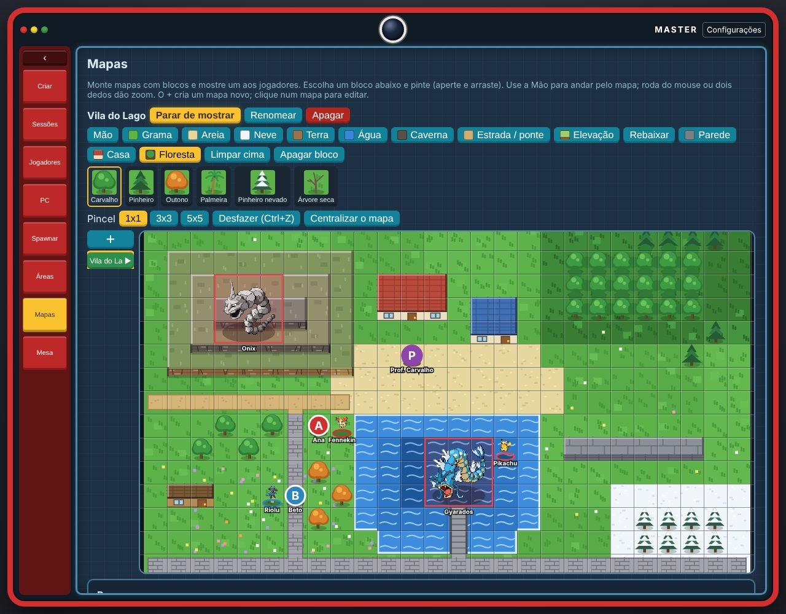
</p>

> **Fan project, non-profit / Projeto de fã, sem fins lucrativos.** Not affiliated with Nintendo, Game Freak, Creatures or The Pokémon Company.
> Pokémon and all related names, images and sounds belong to their owners. Sprites and cries come from public fan sources
> (such as PokeAPI) and are here only for personal use at tabletop RPG sessions. If you are a rights holder and want
> something removed, open an issue. / Não é afiliado à Nintendo, Game Freak, Creatures nem The Pokémon Company. Pokémon e todos
> os nomes, imagens e sons pertencem aos seus donos; os sprites e cries vêm de fontes públicas de fãs (como o PokeAPI) e estão
> aqui só para uso pessoal em mesas de RPG. Se você é titular de direitos e quer algo removido, abra uma issue.

---

<a id="pt"></a>

# 🇧🇷 Português

## O que é

Um app web de apoio ao RPG **Pokémon Tabletop United (PTU)**. O **Mestre** roda o programa no próprio computador e os
**jogadores** entram pelo navegador do celular ou do PC, **de qualquer lugar**, com um link e um código (ou lendo um QR).
Não precisa instalar nada nos aparelhos dos jogadores e não precisa pagar hospedagem.

Tudo funciona em **português e inglês** (troque em *Configurações*).

## O que tem dentro

- **Pokédex completa do PTU** (972 formas do livro 1.05 + Alola + Galar), com tipos, habilidades, capacidades e evoluções.
- **Spawn e captura:** o Mestre faz aparecer um Pokémon selvagem (ou sorteia de uma **Área** com faixa de nível), define quantas
  bolas valem e quem captura primeiro leva.
- **Elenco, PC e mochila** de cada jogador: nível, XP, HP, pontos de atributo, evolução, apelido, boxes do PC.
- **Pokédex em álbum de figurinhas:** o jogador vê o Pokémon, captura, ganha uma figurinha num pacote, abre o pacote e cola no álbum
  (por região; os shiny têm um álbum separado).
- **Mesa virtual:** uma mesa redonda compartilhada, onde o Mestre joga itens e cada jogador pega o que quiser com a mãozinha.
  Os itens têm física, e o **baú** de cada jogador fica logo embaixo da mesa.
- **Mapas:** editor de mapa dentro do programa, com várias variantes de blocos, relevo em vários níveis, peças dos jogadores,
  Pokémon e NPCs no mapa (os Pokémon ocupam o tamanho certo do PTU).
- **Ferramentas do Mestre:** dar XP, definir nível e HP, dar Pokémon e itens, resolver pedidos dos jogadores, ver o que cada um
  está fazendo, expulsar, zerar a Pokédex de alguém.

## Capturas de tela

| Mestre: convite e sessões | Mestre: jogadores |
|---|---|
| 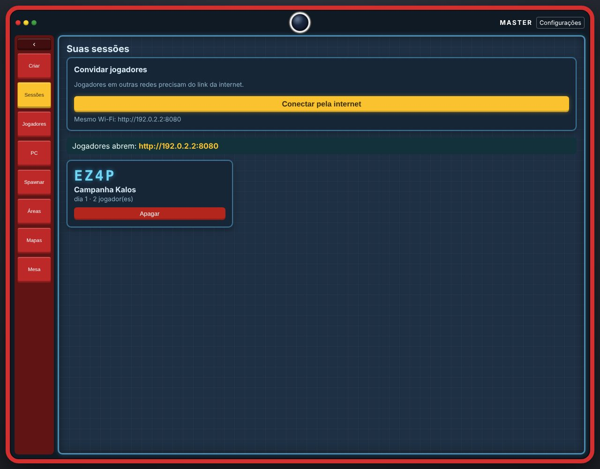 | 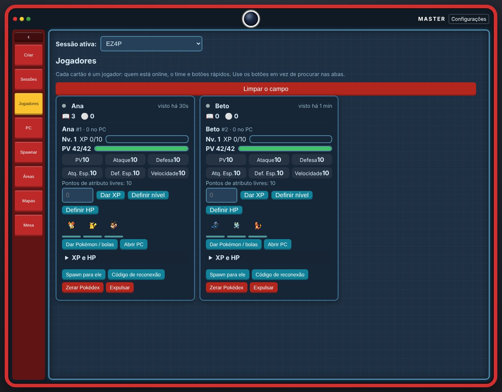 |
| **Mestre: spawn de Pokémon** | **Mestre: mesa virtual** |
| 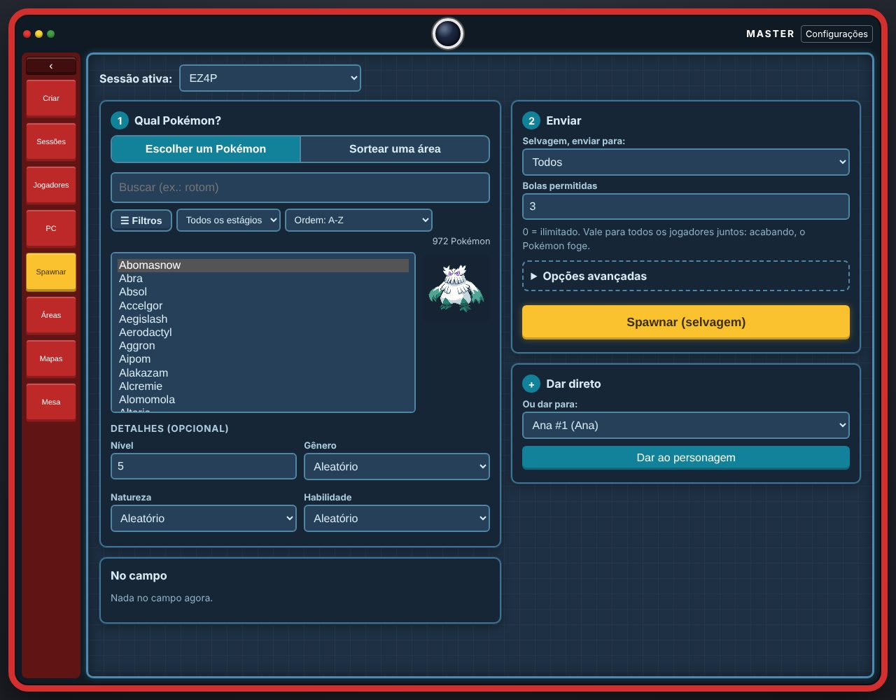 | 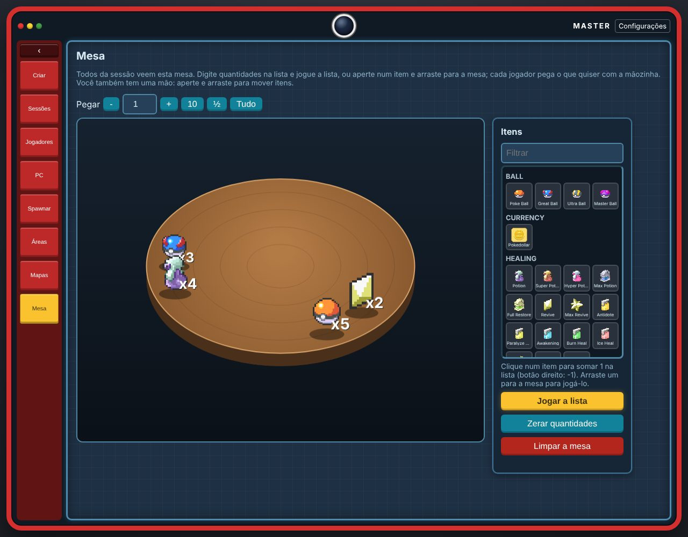 |

**Visão do jogador (celular):**

<p>
  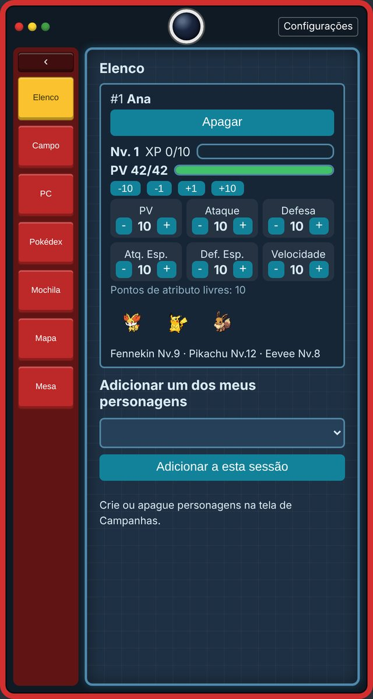
  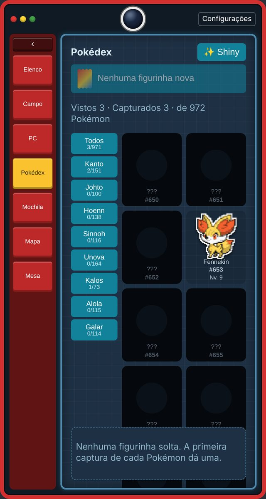
  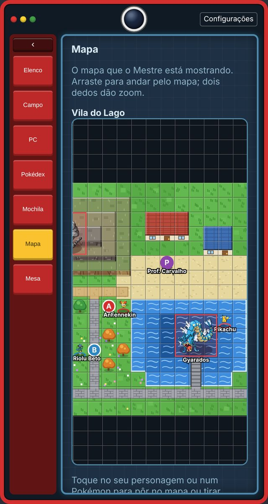
  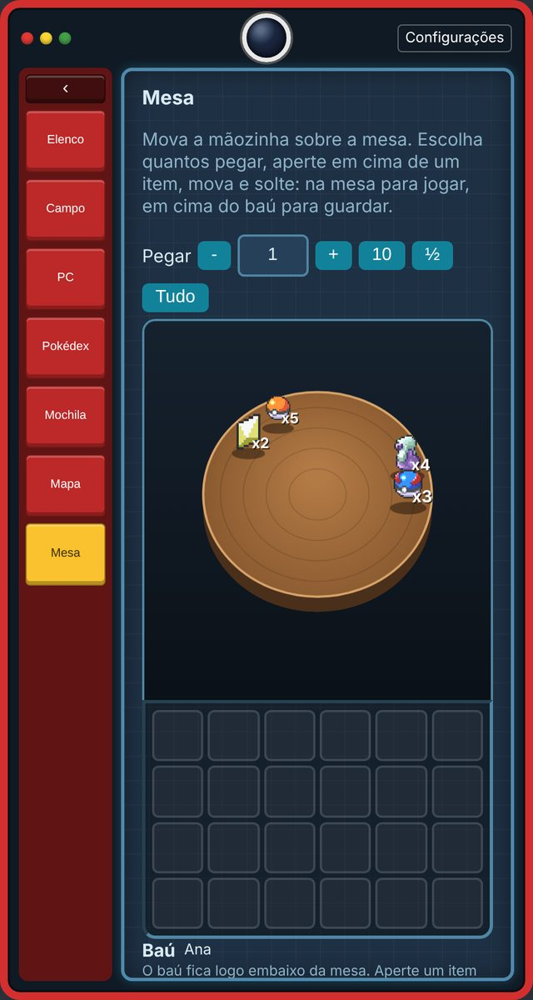
</p>

## Vídeos curtos

**Spawn (Mestre e jogador lado a lado)**

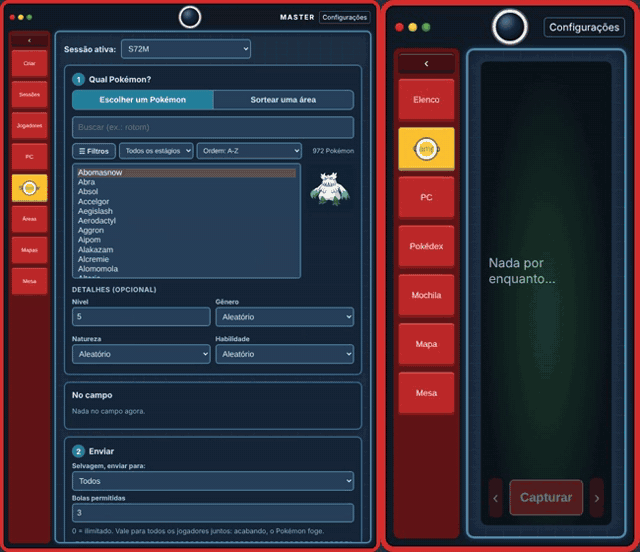

**Captura**

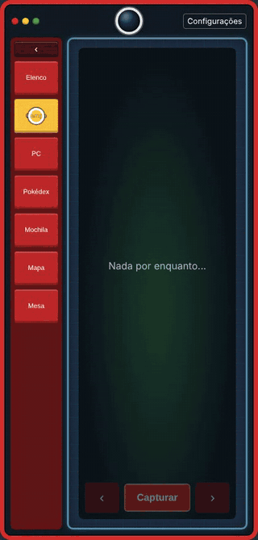

**Evolução**

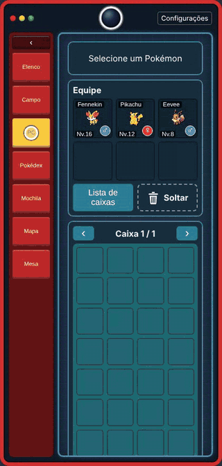

**Mover Pokémon (equipe ↔ PC)**

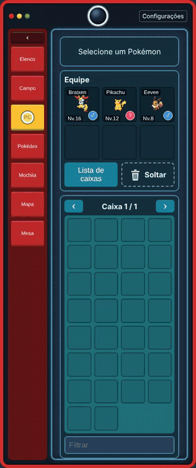

**Pegar item da mesa**

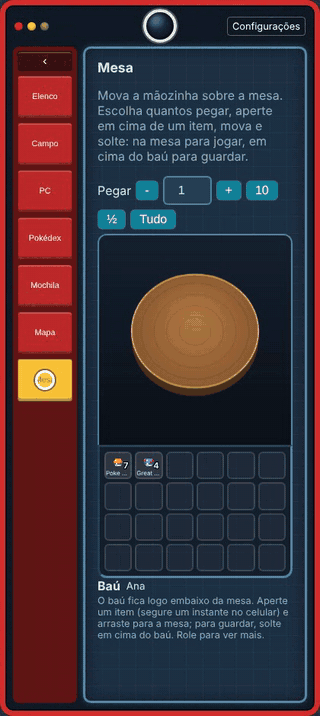

**Colar figurinha**

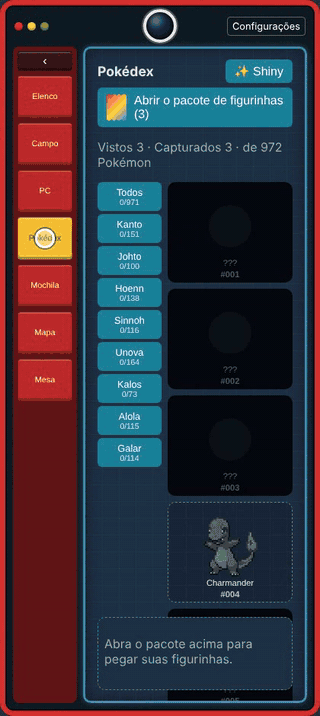

## Para o Mestre: baixar e jogar

1. Abra a aba **Releases** deste repositório.
2. Baixe `PTU-Mestre-Windows.zip` (Windows) ou `PTU-Mestre-Linux.tar.gz` (Linux) e extraia numa pasta qualquer.
3. **Windows:** dois cliques em `Iniciar.bat`. **Linux:** `./iniciar.sh`.
4. A página do Mestre abre sozinha no navegador. Na aba **Sessões**, clique em **Conectar pela internet** e depois em
   **Copiar convite**: ele traz o link, o código da sessão e o QR. Mande aos jogadores (WhatsApp, Discord, etc.).
5. Para encerrar, feche a janela preta.

Não precisa instalar Java: ele já vai dentro do pacote. Na primeira vez o programa baixa o `cloudflared` (gratuito, da
Cloudflare) para criar o link da internet; precisa de internet nessa hora. **O link muda a cada vez que o programa abre**, então
mande o convite de novo a cada sessão. Se o Windows perguntar sobre o firewall, pode permitir.

> **Seus dados** (campanhas, personagens, mapas) ficam na pasta do programa: `pokemon.db` e arquivos `*.dat`.
> **Ao atualizar de versão, copie esses arquivos da pasta antiga para a nova.**

### Passo a passo de uma sessão

1. **Criar:** na aba *Criar*, crie a sessão (campanha). O código de 4 letras aparece na aba *Sessões*.
2. **Convidar:** mande o convite. Os jogadores abrem o link, digitam o nome e entram (ou leem o QR).
3. **Preparar:** na aba *Jogadores*, escolha a sessão ativa. Cada jogador tem um cartão com o time e botões rápidos
   (dar XP, dar Pokémon, abrir o PC, spawn só para ele...).
4. **Jogar:** na aba *Spawnar*, escolha um Pokémon (ou sorteie de uma *Área*), defina quantas bolas valem e envie.
   Os jogadores veem o Pokémon na tela *Campo* e capturam.
5. **Mapa e mesa:** use as abas *Mapas* e *Mesa* (explicadas abaixo).

### Mapas

Na aba **Mapas** o Mestre monta o mapa da cena e escolhe qual mostrar aos jogadores.

- O **+** cria um mapa novo (eles ficam salvos); clique num mapa para editar. **Mostrar aos jogadores** / **Parar de mostrar** controla
  o que eles veem.
- O mapa é uma **grade infinita**: cresce sozinho conforme você pinta. Ferramenta **Mão** arrasta o mapa; roda do mouse (ou dois
  dedos) dá zoom. **Ctrl+Z** desfaz.
- **Blocos:** grama, areia, neve, terra, água, caverna, estrada/ponte, parede, casa e floresta. Cada um tem **variantes**
  (por exemplo: grama florida, mar fundo, lava, estrada de tijolo, casa azul, pinheiro nevado...). Escolha o bloco e depois a variante
  na faixa que aparece embaixo.
- **Relevo:** níveis de 1 a 4, um em cima do outro (montanha em cima de montanha). *Rebaixar* volta ao chão.
- **Pontes:** estrada sobre água ou vazio vira ponte automaticamente.
- **Pincel** 1x1, 3x3 ou 5x5.
- **Peças:** em *Peças no mapa*, ponha jogadores, os Pokémon deles, NPCs e Pokémon selvagens (qualquer espécie, sem precisar dar spawn
  antes). Com a ferramenta **Mão**, arraste as peças. Os Pokémon grandes ocupam o tamanho do PTU: Large 2x2, Huge 3x3, Gigantic 4x4.
- O mapa é **livre**: não há bloqueio de movimento; o Mestre decide as regras na mesa.

### Mesa e itens

Na aba **Mesa**, o Mestre escolhe itens da lista e joga na mesa (ou arrasta um item para ela). Os jogadores pegam com a mãozinha e
guardam no **baú**. A pilha é total (por exemplo, 10 Poké Balls para todos; cada um pega quantas quiser).

## Para o jogador

1. Abra o link que o Mestre mandou (ou leia o QR) e digite seu nome **uma vez**: o aparelho lembra. Da próxima vez, ler o QR já entra direto.
2. Em **Elenco**, crie ou adicione seu personagem. Cada sessão tem a sua cópia do personagem.
3. As abas: **Campo** (Pokémon que apareceram e botão *Capturar*), **PC**, **Pokédex** (álbum de figurinhas), **Mochila**, **Mapa** e **Mesa**.
4. **Trocar de aparelho:** na tela inicial, abra *Usar em outro aparelho* e copie o link. Abra-o no outro aparelho para continuar com o
   mesmo nome, personagens e campanhas. Não compartilhe esse link.
5. Perdeu o acesso a uma sessão? Peça ao Mestre um *código de reconexão* ou use *Sim, sou eu — pedir ao Mestre* para ele aprovar.

### Segurança

Só a página aberta **neste computador** tem poderes de Mestre. Quem entra pelo link da internet (ou pelo Wi-Fi) entra sempre como
jogador: o servidor recusa pedidos de Mestre que chegam com cabeçalhos de proxy/túnel ou com nome de host público. Não compartilhe o
endereço da página do Mestre (`localhost`).

## Problemas comuns

- **Jogador não consegue entrar:** confirme que você clicou em *Conectar pela internet* e mandou o convite **desta vez** (o link muda).
  No mesmo Wi-Fi, também funciona o endereço da rede local que aparece na aba *Sessões*.
- **Perdi minhas campanhas ao atualizar:** copie `pokemon.db` e os arquivos `*.dat` da pasta antiga para a pasta nova.
- **Página com cara antiga depois de atualizar:** aperte **Ctrl+F5**.
- **Porta ocupada:** feche outra cópia do programa; ele usa a porta 8080.

## Para quem desenvolve

Projeto Java (Eclipse, módulo `Pokemon`) + páginas web puras em `web/` (sem build: edite e dê F5).

```
src/Server/...        servidor (Java 21+): banco SQLite, regras PTU, servidor web, túnel
web/                  páginas do Mestre e do Jogador (HTML/JS/CSS), sprites e cries em web/assets
pokemon.json          dados de todos os Pokémon (lido na primeira execução para criar o pokemon.db)
packaging/            build do pacote sem instalação (jlink) e lançadores
.github/workflows/    gera os pacotes Windows e Linux e publica em Releases
docs/img/             imagens deste README
```

Rodar em desenvolvimento: execute `Server.Server` (Eclipse, ou `java -cp bin:lib/sqlite-jdbc.jar Server.Server`) e abra
`http://localhost:8080/master`. Na aba *Sessões*, o botão **Conectar pela internet** liga o túnel (em desenvolvimento ele não liga
sozinho). Gerar o pacote do seu sistema (precisa de JDK 21+): `bash packaging/build.sh` → `dist/PTU-Mestre/`.

Publicar uma versão (gera os dois pacotes em Releases):

```bash
git tag v1.0.0
git push origin v1.0.0
```

O `pokemon.db`, os `*.dat` e a pasta `tools/` ficam fora do Git (`.gitignore`).

---

<a id="en"></a>

# 🇺🇸 English

## What is this

A web app that supports the tabletop RPG **Pokémon Tabletop United (PTU)**. The **Game Master** runs the program on their own
computer and the **players** join from a phone or PC browser, **from anywhere**, with a link and a code (or by scanning a QR).
Nothing to install on the players' devices, and no hosting fees.

Everything works in **Portuguese and English** (switch in *Settings*). The screenshots below show the Portuguese interface.

## Features

- **Full PTU Pokédex** (972 forms from the 1.05 book + Alola + Galar) with types, abilities, capabilities and evolutions.
- **Spawn and capture:** the GM makes a wild Pokémon appear (or rolls one from an **Area** with a level range), sets how many balls
  count, and the first player to capture it keeps it.
- **Party, PC and bag** for each player: level, XP, HP, stat points, evolution, nicknames, PC boxes.
- **Sticker-album Pokédex:** the player sees a Pokémon, captures it, gets a sticker in a pack, opens the pack and sticks it in the album
  (by region; shinies have their own album).
- **Virtual table:** a shared round table where the GM throws items and each player grabs what they want with a little hand.
  Items have physics, and each player's **chest** sits right under the table.
- **Maps:** a map editor inside the program, with many block variants, multi-level elevation, player pieces, Pokémon and NPCs on the
  map (Pokémon take their real PTU size).
- **GM tools:** give XP, set level and HP, give Pokémon and items, answer player requests, see what everyone is doing, kick players,
  reset someone's Pokédex.

## Screenshots

| GM: invite and sessions | GM: players |
|---|---|
|  |  |
| **GM: Pokémon spawn** | **GM: virtual table** |
|  |  |

**Player view (phone):**

<p>
  
  
  
  
</p>

## Short clips

**Spawn (GM and player side by side)**


**Capture**


**Evolution**


**Move a Pokémon (party ↔ PC)**


**Take an item from the table**


**Stick a sticker**


## For the GM: download and play

1. Open the **Releases** tab of this repository.
2. Download `PTU-Mestre-Windows.zip` (Windows) or `PTU-Mestre-Linux.tar.gz` (Linux) and extract it anywhere.
3. **Windows:** double-click `Iniciar.bat`. **Linux:** run `./iniciar.sh`.
4. The GM page opens in your browser. In the **Sessions** tab, click **Connect to the internet**, then **Copy invite**: it has the
   link, the session code and a QR. Send it to your players (WhatsApp, Discord, etc.).
5. To quit, close the black window.

No need to install Java: it is bundled. The first time, the program downloads `cloudflared` (free, from Cloudflare) to create the
internet link, so you need to be online. **The link changes every time the program starts**, so send the invite again each session.
If Windows asks about the firewall, allow it.

> **Your data** (campaigns, characters, maps) lives in the program folder: `pokemon.db` and the `*.dat` files.
> **When updating to a new version, copy those files from the old folder to the new one.**

### A session, step by step

1. **Create:** in the *Create* tab, create the session (campaign). The 4-letter code shows in the *Sessions* tab.
2. **Invite:** send the invite. Players open the link, type their name and join (or scan the QR).
3. **Prepare:** in the *Players* tab, pick the active session. Each player has a card with their team and quick buttons
   (give XP, give Pokémon, open PC, spawn only for them...).
4. **Play:** in the *Spawn* tab, pick a Pokémon (or roll from an *Area*), set how many balls count and send it. Players see the
   Pokémon in their *Wild* tab and capture it.
5. **Map and table:** use the *Maps* and *Table* tabs (below).

### Maps

In the **Maps** tab the GM builds the scene map and chooses which one the players see.

- The **+** creates a new map (they are saved); click a map to edit it. **Show to players** / **Stop showing** controls what they see.
- The map is an **endless grid**: it grows as you paint. The **Hand** tool drags the map; mouse wheel (or two fingers) zooms.
  **Ctrl+Z** undoes.
- **Blocks:** grass, sand, snow, dirt, water, cave, road/bridge, wall, house and forest. Each has **variants** (for example: flower
  meadow, deep sea, lava, brick road, blue house, snowy pine...). Pick the block, then the variant in the strip that appears below.
- **Elevation:** levels 1 to 4, stacked (mountain on top of mountain). *Lower* goes back to the ground.
- **Bridges:** a road over water or void becomes a bridge automatically.
- **Brush** 1x1, 3x3 or 5x5.
- **Pieces:** under *Pieces on the map*, place players, their Pokémon, NPCs and wild Pokémon (any species, no need to spawn it first).
  With the **Hand** tool, drag the pieces. Big Pokémon use their PTU size: Large 2x2, Huge 3x3, Gigantic 4x4.
- The map is **free**: there is no movement blocking; the GM decides the rules at the table.

### Table and items

In the **Table** tab, the GM picks items from the list and throws them on the table (or drags one onto it). Players grab them with
their hand and keep them in the **chest**. The pile is shared (for example, 10 Poké Balls for everyone; each takes as many as they like).

## For players

1. Open the link the GM sent (or scan the QR) and type your name **once**: the device remembers it. Next time, scanning the QR joins directly.
2. In **Trainers**, create or add your character. Each session has its own copy of the character.
3. The tabs: **Wild** (Pokémon that appeared, with a *Capture* button), **PC**, **Pokédex** (sticker album), **Bag**, **Map** and **Table**.
4. **Switching devices:** on the home screen, open *Use on another device* and copy the link. Open it on the other device to keep
   the same name, characters and campaigns. Do not share this link.
5. Lost access to a session? Ask the GM for a *reconnect code*, or use *Yes, it is me — ask the Master* so the GM can approve you.

### Security

Only the page opened **on this computer** has Game Master powers. Anyone arriving through the internet link (or the Wi-Fi) is always a
player: the server refuses GM requests that come with proxy/tunnel headers or a public host name. Do not share the address of the
GM page (`localhost`).

## Common problems

- **A player cannot join:** make sure you clicked *Connect to the internet* and sent the invite **this time** (the link changes).
  On the same Wi-Fi, the local network address shown in the *Sessions* tab also works.
- **Lost my campaigns after updating:** copy `pokemon.db` and the `*.dat` files from the old folder to the new one.
- **Page looks old after updating:** press **Ctrl+F5**.
- **Port in use:** close another copy of the program; it uses port 8080.

## For developers

Java project (Eclipse, module `Pokemon`) + plain web pages in `web/` (no build: edit and press F5).

```
src/Server/...        server (Java 21+): SQLite database, PTU rules, web server, tunnel
web/                  GM and player pages (HTML/JS/CSS), sprites and cries in web/assets
pokemon.json          data of every Pokémon (read on first run to create pokemon.db)
packaging/            no-install package build (jlink) and launchers
.github/workflows/    builds the Windows and Linux packages and publishes them in Releases
docs/img/             images used by this README
```

Run in development: start `Server.Server` (Eclipse, or `java -cp bin:lib/sqlite-jdbc.jar Server.Server`) and open
`http://localhost:8080/master`. In the *Sessions* tab, the **Connect to the internet** button starts the tunnel (it does not start by
itself in development). To build the package for your system (needs JDK 21+): `bash packaging/build.sh` → `dist/PTU-Mestre/`.

Publish a version (builds both packages in Releases):

```bash
git tag v1.0.0
git push origin v1.0.0
```

`pokemon.db`, the `*.dat` files and the `tools/` folder stay out of Git (`.gitignore`).
